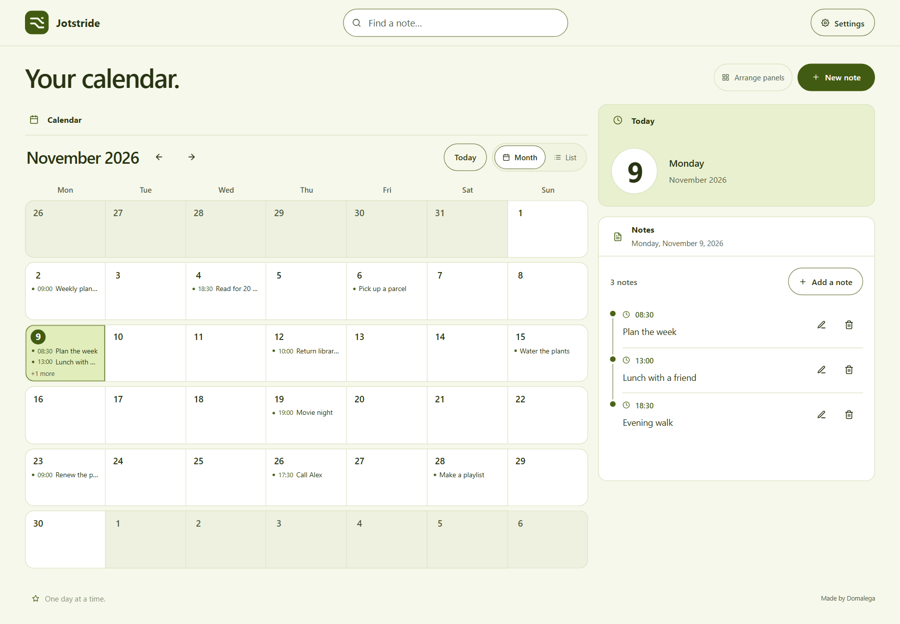
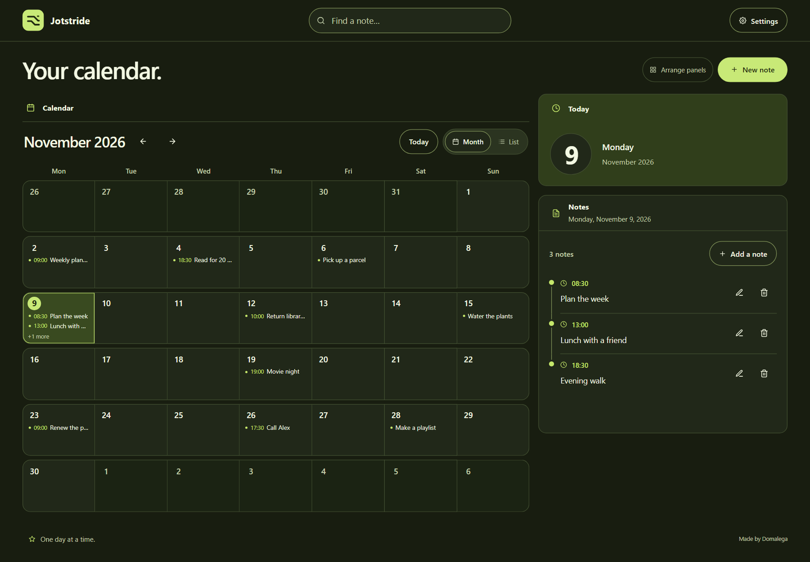

# Jotstride

English · [Русский](README.ru.md)

Jotstride is a personal calendar for notes, tasks and reminders. Browse the month, see the notes for a day, or search across your notes. You can also turn on a to-do list, a Kanban board and a medication tracker.

[Open Jotstride](https://domalega.github.io/diploma/) · [Install for Android or Windows](apps/README.md) · [Run locally](#run-locally) · [Documentation](#documentation)

You can enable end-to-end encryption in Settings. Jotstride creates the keys and asks you to approve each new device from one you've already connected. If you already have an account, read [what encryption protects](docs/ENCRYPTION.md) before turning it on.

## Tech stack

Jotstride uses React 18, Express and Sequelize. The local setup below uses SQLite, and the hosted setup uses PostgreSQL.

## Run locally

You'll need Node.js 22 or newer and npm.

1. From the repository root, install the dependencies.

   ```sh
   npm run setup
   ```

2. Copy [`server/.env.example`](server/.env.example) to `server/.env`. Run the command below and paste the generated value into `SECRET_KEY` in `server/.env`.

   ```sh
   node -e "console.log(require('node:crypto').randomBytes(32).toString('hex'))"
   ```

3. From the repository root, start the API and frontend in separate terminals.

   ```sh
   npm run dev:server
   ```

   ```sh
   npm run dev:client
   ```

4. Open [localhost:3000](http://localhost:3000). The API listens on port `5000` and creates the SQLite database at `server/data/calendar.sqlite`.

If the API runs at a different address, copy [`client/.env.example`](client/.env.example) to `client/.env` and set `REACT_APP_API_URL`. The server example lists the PostgreSQL settings.

To test password recovery locally, look for the generated emails in `server/data/mail/`. For hosted email delivery, follow the [Google Apps Script setup](integrations/google-mail/README.md).

## Checks

Run these commands from the repository root. See [Build the device clients](apps/README.md#build) for Android and Windows checks.

```sh
npm test
npm run lint
npm run build
```

## Documentation

- [Install, configure and build the Android and Windows apps](apps/README.md)
- [Set up encryption or connect a device](docs/ENCRYPTION.md)
- [Use Android offline and resolve sync conflicts](docs/OFFLINE_SYNC.md)
- [Update Android or move data from version 0.2.0](docs/ANDROID_UPDATES.md)
- [Deploy the website and API](docs/DEPLOYMENT.md)
- [Set up password recovery emails](integrations/google-mail/README.md)
- [See what's planned](docs/ROADMAP.md)

## Screenshots

### Light theme



### Dark theme


