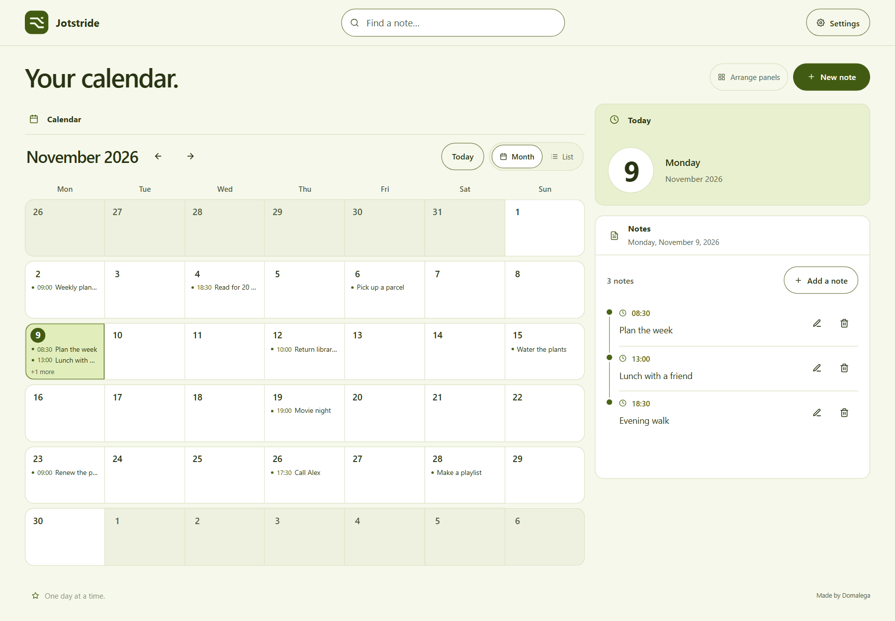
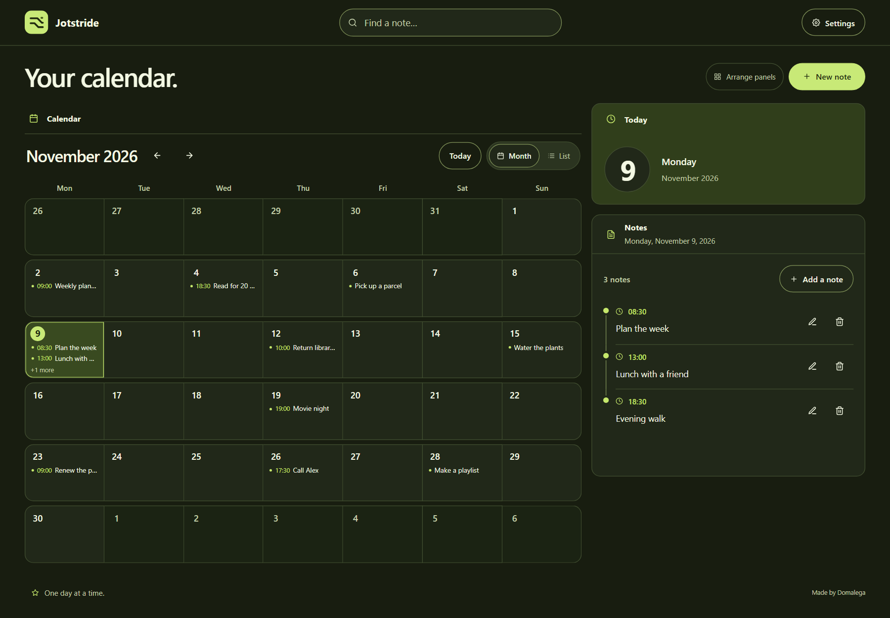

# Jotstride

[English](README.md) · Русский

Jotstride — личный календарь для заметок, задач и напоминаний. В нём можно посмотреть весь месяц, открыть заметки на выбранный день или найти нужную заметку через поиск. В настройках можно включить список дел, доску Канбан и учёт приёма лекарств.

[Открыть Jotstride](https://domalega.github.io/diploma/) · [Установить на Android или Windows](docs/ru/APPS.md) · [Запустить локально](#локальный-запуск) · [Документация](#документация)

В настройках можно включить сквозное шифрование. Jotstride создаст ключи и попросит подтвердить каждое новое устройство с уже подключённого. Если у вас есть аккаунт с данными, сначала прочитайте, [что защищает шифрование](docs/ru/ENCRYPTION.md).

## Технологии

Jotstride использует React 18, Express и Sequelize. Для локального запуска используется SQLite, для размещения на сервере — PostgreSQL.

## Локальный запуск

Понадобятся Node.js 22 или новее и npm.

1. Установите зависимости из корня репозитория.

   ```sh
   npm run setup
   ```

2. Скопируйте [`server/.env.example`](server/.env.example) в `server/.env`. Выполните команду ниже и вставьте полученное значение в `SECRET_KEY` в файле `server/.env`.

   ```sh
   node -e "console.log(require('node:crypto').randomBytes(32).toString('hex'))"
   ```

3. Из корня репозитория запустите API и интерфейс в отдельных терминалах.

   ```sh
   npm run dev:server
   ```

   ```sh
   npm run dev:client
   ```

4. Откройте [localhost:3000](http://localhost:3000). API будет доступен на порту `5000` и создаст базу SQLite в `server/data/calendar.sqlite`.

Если API работает по другому адресу, скопируйте [`client/.env.example`](client/.env.example) в `client/.env` и задайте `REACT_APP_API_URL`. Настройки PostgreSQL приведены в примере для сервера.

Чтобы проверить восстановление пароля локально, ищите сформированные письма в `server/data/mail/`. Для отправки писем с сервера настройте [Google Apps Script](docs/ru/GOOGLE_MAIL.md).

## Проверки

Выполните команды из корня репозитория. Проверки для приложений Android и Windows описаны в [разделе о сборке](docs/ru/APPS.md#сборка).

```sh
npm test
npm run lint
npm run build
```

## Документация

- [Установка, настройка и сборка приложений для Android и Windows](docs/ru/APPS.md)
- [Настройка шифрования и подключение устройств](docs/ru/ENCRYPTION.md)
- [Работа без интернета на Android и разрешение конфликтов](docs/ru/OFFLINE_SYNC.md)
- [Обновление Android и перенос данных из версии 0.2.0](docs/ru/ANDROID_UPDATES.md)
- [Развёртывание сайта и API](docs/ru/DEPLOYMENT.md)
- [Настройка писем для восстановления пароля](docs/ru/GOOGLE_MAIL.md)
- [Планы развития](docs/ru/ROADMAP.md)

## Скриншоты

### Светлая тема



### Тёмная тема


